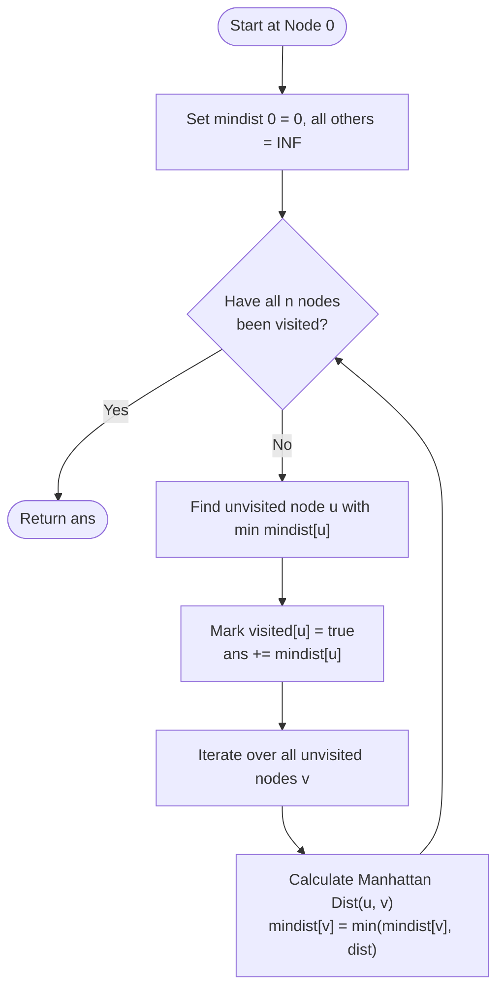

<h2><a href="https://leetcode.com/problems/min-cost-to-connect-all-points">1584. Min Cost to Connect All Points</a></h2>

<p>You are given an array <code>points</code> representing integer coordinates of some points on a 2D-plane, where <code>points[i] = [x<sub>i</sub>, y<sub>i</sub>]</code>.</p>

<p>The cost of connecting two points <code>[x<sub>i</sub>, y<sub>i</sub>]</code> and <code>[x<sub>j</sub>, y<sub>j</sub>]</code> is the <strong>manhattan distance</strong> between them: <code>|x<sub>i</sub> - x<sub>j</sub>| + |y<sub>i</sub> - y<sub>j</sub>|</code>, where <code>|val|</code> denotes the absolute value of <code>val</code>.</p>

<p>Return <em>the minimum cost to make all points connected.</em> All points are connected if there is <strong>exactly one</strong> simple path between any two points.</p>

<p>&nbsp;</p>
<p><strong class="example">Example 1:</strong></p>

<pre><strong>Input:</strong> points = [[0,0],[2,2],[3,10],[5,2],[7,0]]
<strong>Output:</strong> 20
<strong>Explanation:</strong> 

We can connect the points as shown above to get the minimum cost of 20.
Notice that there is a unique path between every pair of points.
</pre>

<p><strong class="example">Example 2:</strong></p>

<pre><strong>Input:</strong> points = [[3,12],[-2,5],[-4,1]]
<strong>Output:</strong> 18
</pre>

<p>&nbsp;</p>
<p><strong>Constraints:</strong></p>

<ul>
	<li><code>1 &lt;= points.length &lt;= 1000</code></li>
	<li><code>-10<sup>6</sup> &lt;= x<sub>i</sub>, y<sub>i</sub> &lt;= 10<sup>6</sup></code></li>
	<li>All pairs <code>(x<sub>i</sub>, y<sub>i</sub>)</code> are distinct.</li>
</ul>


---

# 🛍️ Min-Cost-to-Connect-All-Points | Explained

## Approach 1: Prim's Algorithm (Dense Graph Array-Based Optimization)

### Intuition
Imagine you are tasked with connecting a group of remote towns to an electrical power grid. You can start by placing a generator at any town for free. From there, each step involves finding the closest unconnected town to any town that is already electrified, building a power line to it, and adding it to the grid. By always making the locally optimal choice—connecting the nearest town to the active network—you expand the grid until all towns are powered with the minimum total wire length. 

This is the exact principle behind **Prim's Algorithm** for finding a Minimum Spanning Tree (MST). Because every point can potentially connect to every other point, this problem defines a **complete (dense) graph** with $V = n$ vertices and $E \approx \frac{n^2}{2}$ edges. Instead of maintaining a binary heap (which incurs an overhead of $O(E \log V)$), a simple array-based linear scan achieves $O(V^2)$ time, which is optimal for dense graphs where $E \in \Theta(V^2)$.

### Algorithm Visualized



### Approach
1. **State Tracking**: 
   - Maintain an array `mindist` where `mindist[i]` represents the shortest distance from node $i$ to any node already included in the MST.
   - Maintain a boolean array `visited` where `visited[i] = true` indicates node $i$ is part of the MST.
2. **Initialization**:
   - Arbitrarily pick node $0$ as the starting point by setting `mindist[0] = 0`. All other nodes start with `mindist[i] = INT_MAX`.
   - Initialize total cost `ans = 0`.
3. **Iterative Expansion (Run $n$ times)**:
   - **Extract Min**: Scan through all nodes to find an unvisited node $u$ with the smallest `mindist[u]`.
   - **Incorporate Node**: Mark $u$ as visited and add `mindist[u]` to `ans`.
   - **Relaxation**: For every remaining unvisited node $v$, calculate the Manhattan distance between $u$ and $v$: 
     $$\text{dist} = |x_u - x_v| + |y_u - y_v|$$
   - Update `mindist[v] = min(mindist[v], dist)`.
4. **Result**: After $n$ iterations, all vertices have been visited, forming an MST of minimal cost `ans`.

### Detailed Code Analysis

- **Lines 4–8**:
  ```cpp
  int n = points.size();
  vector<int> mindist(n, INT_MAX);
  vector<bool> visited(n, false);
  ```
  We store the number of points $n$. `mindist` tracks the minimum edge weight required to connect each point to the growing tree, initialized to infinity (`INT_MAX`). `visited` tracks the inclusion of nodes in the tree to prevent cycle formation.

- **Lines 10–11**:
  ```cpp
  mindist[0] = 0;
  int ans = 0;
  ```
  Node $0$ is chosen as the arbitrary root of the MST. Setting `mindist[0] = 0` ensures it is chosen first with zero cost penalty. `ans` will accumulate the weights of the $n - 1$ edges selected.

- **Line 13**:
  ```cpp
  for (int i = 0; i < n; i++) {
  ```
  An MST on $n$ vertices requires including exactly $n$ vertices (and thus $n - 1$ edges plus the initial root entry).

- **Lines 14–19**:
  ```cpp
  int u = -1;
  for (int j = 0; j < n; j++) {
      if (!visited[j] && (u == -1 || mindist[j] < mindist[u])) 
          u = j;
  }
  ```
  This is the $O(n)$ search for the minimum-weight connection to the currently established tree. It iterates over all points and selects an unvisited candidate $j$ that minimizes `mindist[j]`.

- **Lines 20–21**:
  ```cpp
  visited[u] = true;
  ans += mindist[u];
  ```
  Node $u$ is committed to the MST by marking it as visited. `mindist[u]` (which holds the weight of the cheapest edge connecting $u$ to the existing tree) is added to `ans`.

- **Lines 22–27**:
  ```cpp
  for (int v = 0; v < n; v++) {
      if (!visited[v]) {
          int dist = abs(points[v][0] - points[u][0]) + abs(points[v][1] - points[u][1]);
          mindist[v] = min(mindist[v], dist);
      }
  }
  ```
  **Relaxation step**: Now that $u$ is in the MST, we check if $u$ offers a shorter path to any unvisited node $v$ than previously discovered. We compute the Manhattan distance between $u$ and $v$ on the fly without precomputing or storing all $O(n^2)$ edges in memory. If `dist < mindist[v]`, we update `mindist[v]`.

- **Line 29**:
  ```cpp
  return ans;
  ```
  Returns the accumulated weight of the MST.

### Code
```cpp
class Solution {
public:
    // Prim's Algorithm (Dense Graph Optimization)
    int minCostConnectPoints(vector<vector<int>>& points) {
        int n = points.size();

        vector<int> mindist(n, INT_MAX);
        vector<bool> visited(n, false);

        mindist[0] = 0;
        int ans = 0;

        for (int i = 0; i < n; i++) {
            int u = -1;

            // Find unvisited node with minimum distance to MST
            for (int j = 0; j < n; j++) {
                if (!visited[j] && (u == -1 || mindist[j] < mindist[u])) {
                    u = j;
                }
            }

            visited[u] = true;
            ans += mindist[u];

            // Relax distances to all unvisited neighbors
            for (int v = 0; v < n; v++) {
                if (!visited[v]) {
                    int dist = abs(points[v][0] - points[u][0]) + abs(points[v][1] - points[u][1]);
                    mindist[v] = min(mindist[v], dist);
                }
            }
        }
        return ans;
    }
};
```

### Complexity
- **Time:** $O(n^2)$
  - Outer loop runs $n$ times.
  - Finding the minimum distance vertex takes $O(n)$ time.
  - Updating the distances of the unvisited neighbors takes $O(n)$ time.
  - Total time complexity: $n \times (O(n) + O(n)) = O(n^2)$.
- **Space:** $O(n)$
  - The algorithm only allocates `mindist` of size $n$ and `visited` of size $n$.
  - Distance values are calculated on the fly, avoiding the $O(n^2)$ space needed to build an explicit adjacency matrix.

---

## 🕵️‍♂️ Follow-up Questions (Optional)

1. **Why is this $O(V^2)$ Prim's approach preferred over Kruskal's or a Min-Heap-based Prim's for this specific problem?**
   - For a complete graph with $V$ vertices, the number of edges is $E = \frac{V(V - 1)}{2} \approx \frac{V^2}{2}$.
   - **Kruskal's Algorithm** requires sorting all edges, giving a time complexity of $O(E \log E) = O(V^2 \log(V^2)) = O(V^2 \log V)$, and consumes $O(V^2)$ memory to store the edges.
   - **Prim's with a Min-Heap / Priority Queue** runs in $O(E \log V) = O(V^2 \log V)$ time and requires $O(E) = O(V^2)$ space.
   - The array-based Prim's algorithm runs in **$O(V^2)$ time and $O(V)$ auxiliary space**, making it both strictly faster asymptotically and dramatically more cache- and memory-friendly.

2. **Can this problem be solved faster than $O(n^2)$?**
   - Yes, using geometric properties of Manhattan distances. By dividing the 2D plane into 8 octants around each point, it can be proven that each point only needs to consider its nearest neighbor in each of the 8 octants. This reduces the number of candidate edges from $O(n^2)$ to $O(n)$. Running Kruskal's algorithm on these $O(n)$ edges with a Fenwick tree (Binary Indexed Tree) yields an optimal time complexity of $O(n \log n)$. However, for $n \le 1000$ (as constrained on LeetCode), the implementation overhead of this approach is usually unnecessary.