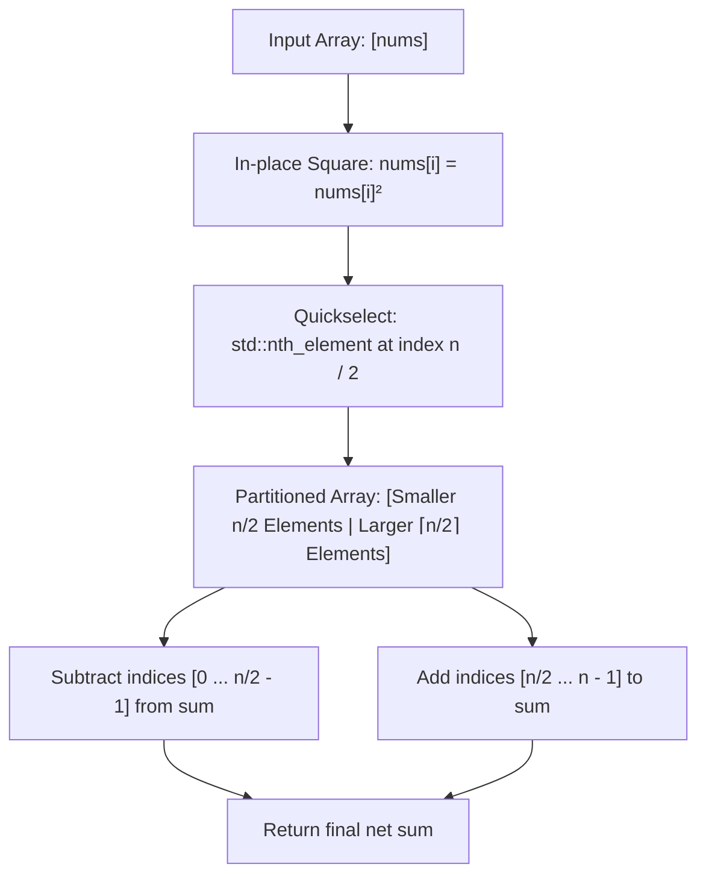

<h2><a href="https://leetcode.com/problems/maximum-alternating-sum-of-squares">3727. Maximum Alternating Sum of Squares</a></h2>

<p>You are given an integer array <code>nums</code>. You may <strong>rearrange the elements</strong> in any order.</p>

<p>The <strong>alternating score</strong> of an array <code>arr</code> is defined as:</p>

<ul>
	<li><code>score = arr[0]<sup>2</sup> - arr[1]<sup>2</sup> + arr[2]<sup>2</sup> - arr[3]<sup>2</sup> + ...</code></li>
</ul>

<p>Return an integer denoting the <strong>maximum possible alternating score</strong> of <code>nums</code> after rearranging its elements.</p>

<p>&nbsp;</p>
<p><strong class="example">Example 1:</strong></p>

<div class="example-block">
<p><strong>Input:</strong> <span class="example-io">nums = [1,2,3]</span></p>

<p><strong>Output:</strong> <span class="example-io">12</span></p>

<p><strong>Explanation:</strong></p>

<p>A possible rearrangement for <code>nums</code> is <code>[2,1,3]</code>, which gives the maximum alternating score among all possible rearrangements.</p>

<p>The alternating score is calculated as:</p>

<p><code>score = 2<sup>2</sup> - 1<sup>2</sup> + 3<sup>2</sup> = 4 - 1 + 9 = 12</code></p>
</div>

<p><strong class="example">Example 2:</strong></p>

<div class="example-block">
<p><strong>Input:</strong> <span class="example-io">nums = [1,-1,2,-2,3,-3]</span></p>

<p><strong>Output:</strong> <span class="example-io">16</span></p>

<p><strong>Explanation:</strong></p>

<p>A possible rearrangement for <code>nums</code> is <code>[-3,-1,-2,1,3,2]</code>, which gives the maximum alternating score among all possible rearrangements.</p>

<p>The alternating score is calculated as:</p>

<p><code>score = (-3)<sup>2</sup> - (-1)<sup>2</sup> + (-2)<sup>2</sup> - (1)<sup>2</sup> + (3)<sup>2</sup> - (2)<sup>2</sup> = 9 - 1 + 4 - 1 + 9 - 4 = 16</code></p>
</div>

<p>&nbsp;</p>
<p><strong>Constraints:</strong></p>

<ul>
	<li><code>1 &lt;= nums.length &lt;= 10<sup>5</sup></code></li>
	<li><code>-4 * 10<sup>4</sup> &lt;= nums[i] &lt;= 4 * 10<sup>4</sup></code></li>
</ul>


---

# 🛍️ Maximum-Alternating-Sum-of-Squares | Explained

## Approach 1: Quickselect Partitioning via `std::nth_element`

### Intuition
Imagine you are playing a tug-of-war game where you have to divide a pool of players into two teams: Team Positive (adds to your score) and Team Negative (subtracts from your score). To maximize the final net score, you would intuitively assign the strongest, heaviest players to Team Positive and the lightest, weakest players to Team Negative. 

In this problem, the contribution of each number is its square ($nums[i]^2$). Because squaring eliminates signs and amplifies magnitudes, we want the largest $\lceil n/2 \rceil$ squared values to be added positively, and the smallest $\lfloor n/2 \rfloor$ squared values to be subtracted. Instead of performing a full $O(n \log n)$ sort, we only need to partition the array around the median element. Using C++'s `std::nth_element` (Quickselect algorithm), we split the array into the lower half and upper half in average linear time $O(n)$.

### Algorithm Visualized



### Approach
1. **Square Transformation:** Iterate through the array and replace each value `nums[i]` with its squared value `nums[i] * nums[i]`.
2. **Median Partitioning (`std::nth_element`):** Apply `std::nth_element` targeting index `n / 2`. This rearranges the array in-place such that:
   - The element at index `n / 2` is placed in the position it would occupy if the array were fully sorted.
   - All elements in the range `[0, n / 2 - 1]` are strictly less than or equal to `nums[n / 2]`.
   - All elements in the range `[n / 2 + 1, n - 1]` are greater than or equal to `nums[n / 2]`.
3. **Accumulate Contributions:**
   - Sum up the larger half from index `n / 2` to `n - 1`.
   - Subtract the smaller half from index `0` to `n / 2 - 1`.
4. **Return Result:** Return the accumulated net total as a 64-bit integer (`long long`) to avoid integer overflow.

### Detailed Code Analysis

```cpp
1class Solution {
2public:
3    long long maxAlternatingSum(vector<int>& nums) {
4        int n = nums.size();
```
- **Lines 3–4:** We retrieve the size `n` of the array. The return type is `long long` because squaring elements and summing them can quickly exceed the 32-bit signed integer limit ($2^{31} - 1$).

```cpp
5        for(int i=0; i<n; i++){
6            nums[i]=nums[i]*nums[i];
7        }
```
- **Lines 5–7:** In-place modification of `nums`. Each value is squared. If `nums[i]` could exceed $\approx 46,340$, `nums[i] * nums[i]` might overflow standard 32-bit signed integers during multiplication; assuming problem constraints allow standard integer squares, this converts each element to its absolute square magnitude.

```cpp
8        nth_element(nums.begin(), nums.begin() + n / 2, nums.end());
```
- **Line 8:** `std::nth_element` is an introselect-based algorithm (a combination of Quickselect and Median-of-Medians fallback). It operates in $O(n)$ average time and partitions the vector around iterator `nums.begin() + n / 2`. It guarantees that elements before `n / 2` are smaller than or equal to `nums[n / 2]`, and elements after are larger than or equal to it.

```cpp
9        long long sum = 0;
10       for(int i=n/2; i<n; i++) sum+=nums[i];
11       for(int i=0; i<(n/2); i++){
12           sum-=nums[i];
13       }
14       return sum;
15   }
16};
```
- **Lines 9–14:** We initialize a 64-bit accumulator `sum = 0`.
  - The loop on Line 10 adds the larger half of the elements (`n - n/2` elements) from `i = n / 2` to `n - 1`.
  - The loop on Line 11 subtracts the smaller half (`n / 2` elements) from `i = 0` to `(n / 2) - 1`.
  - Finally, Line 14 returns the maximized alternating sum.

### Code
```cpp
class Solution {
public:
    long long maxAlternatingSum(vector<int>& nums) {
        int n = nums.size();
        for(int i = 0; i < n; i++) {
            nums[i] = nums[i] * nums[i];
        }
        nth_element(nums.begin(), nums.begin() + n / 2, nums.end());
        long long sum = 0;
        for(int i = n / 2; i < n; i++) sum += nums[i];
        for(int i = 0; i < (n / 2); i++) {
            sum -= nums[i];
        }
        return sum;
    }
};
```

### Complexity
- **Time Complexity:** 
  - **Squaring loop:** $O(n)$ to traverse and square each element.
  - **`std::nth_element`:** $O(n)$ average time (worst-case $O(n)$ in modern C++ standard library implementations using introselect).
  - **Summation loops:** $O(n)$ to iterate through both partitions.
  - **Total Time:** $\mathcal{O}(n)$, significantly faster than a full sorting approach which takes $\mathcal{O}(n \log n)$.
- **Space Complexity:** $\mathcal{O}(1)$ auxiliary space, since all transformations and partitioning are performed directly in-place on the input vector `nums`.

---

## 🕵️‍♂️ Follow-up Questions (Optional)

1. **What if the multiplication `nums[i] * nums[i]` overflows standard 32-bit signed integer limits?**
   - If $|nums[i]| > 46,340$, `nums[i] * nums[i]` will cause 32-bit signed integer overflow (undefined behavior in C++). To make this production-safe, cast before multiplication: `1LL * nums[i] * nums[i]`, and store the results in a `vector<long long>`.

2. **Why use `std::nth_element` over `std::sort`?**
   - `std::sort` does redundant work by establishing complete order across all elements ($O(n \log n)$). `std::nth_element` only guarantees that the element at the target rank is in its correct place and that elements on either side satisfy the partition condition, achieving an optimal $O(n)$ average runtime.