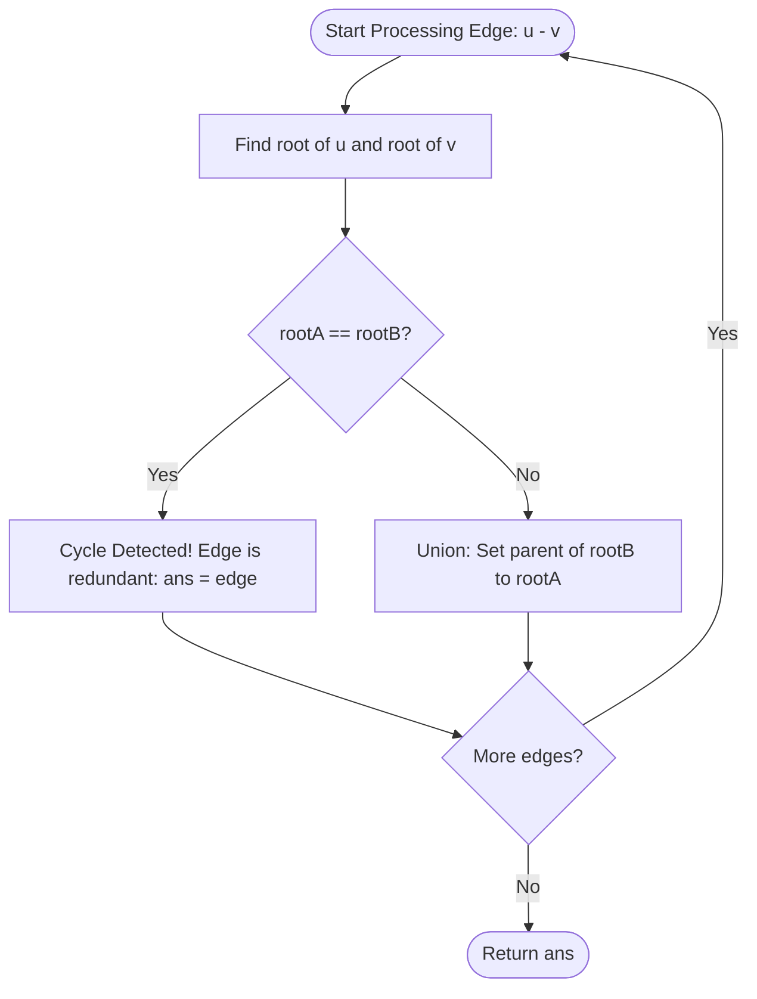

<h2><a href="https://leetcode.com/problems/redundant-connection">684. Redundant Connection</a></h2>

<p>In this problem, a tree is an <strong>undirected graph</strong> that is connected and has no cycles.</p>

<p>You are given a graph that started as a tree with <code>n</code> nodes labeled from <code>1</code> to <code>n</code>, with one additional edge added. The added edge has two <strong>different</strong> vertices chosen from <code>1</code> to <code>n</code>, and was not an edge that already existed. The graph is represented as an array <code>edges</code> of length <code>n</code> where <code>edges[i] = [a<sub>i</sub>, b<sub>i</sub>]</code> indicates that there is an edge between nodes <code>a<sub>i</sub></code> and <code>b<sub>i</sub></code> in the graph.</p>

<p>Return <em>an edge that can be removed so that the resulting graph is a tree of </em><code>n</code><em> nodes</em>. If there are multiple answers, return the answer that occurs last in the input.</p>

<p>&nbsp;</p>
<p><strong class="example">Example 1:</strong></p>

<pre><strong>Input:</strong> edges = [[1,2],[1,3],[2,3]]
<strong>Output:</strong> [2,3]
</pre>

<p><strong class="example">Example 2:</strong></p>

<pre><strong>Input:</strong> edges = [[1,2],[2,3],[3,4],[1,4],[1,5]]
<strong>Output:</strong> [1,4]
</pre>

<p>&nbsp;</p>
<p><strong>Constraints:</strong></p>

<ul>
	<li><code>n == edges.length</code></li>
	<li><code>3 &lt;= n &lt;= 1000</code></li>
	<li><code>edges[i].length == 2</code></li>
	<li><code>1 &lt;= a<sub>i</sub> &lt; b<sub>i</sub> &lt;= edges.length</code></li>
	<li><code>a<sub>i</sub> != b<sub>i</sub></code></li>
	<li>There are no repeated edges.</li>
	<li>The given graph is connected.</li>
</ul>


---

# 🛍️ Redundant-Connection | Explained

## Approach 1: Disjoint Set Union (DSU / Union-Find)

### Intuition
Think of each node as an isolated island, and each given edge as a proposal to build a bridge between two islands. Initially, every island belongs to its own territory. 

When a bridge is proposed between Island $A$ and Island $B$:
1. We check if they already belong to the same territory (i.e., there is already an existing sequence of bridges connecting them).
2. If they do, building this new bridge creates an unnecessary circular path (a cycle). Because the problem specifies that a tree of $n$ nodes was turned into a graph with $n$ edges by adding exactly one redundant connection, the very edge that connects two nodes already in the same territory is our culprit.
3. If they are in different territories, we build the bridge and merge their territories into one.

### Algorithm Visualized


### Approach
1. **Initialize Disjoint Sets:** Create a `parent` array of size $n + 1$ (since node labels are 1-indexed). Initially, every node is its own representative/parent (`parent[i] = i`).
2. **Traverse Edges Sequentially:** Iterate through each edge $[u, v]$ in the order given by the input:
   - Compute `find(u, parent)` and `find(v, parent)`.
   - **Cycle Check:** If both vertices share the exact same root, a path between them already exists. Adding this edge introduces a cycle. We flag this edge as our redundant connection candidate.
   - **Union Operation:** If their roots differ, invoke `unionfn(u, v, parent)` to link the component containing $v$ under the root of $u$.
3. **Return the Result:** Return the edge that closed the cycle.

### Detailed Code Analysis

#### 1. Path Traversal (`find`)
```cpp
int find(int x, vector<int>& parent){
    if(parent[x]==x) return x;
    return find(parent[x],parent);
}
```
- **Base Case:** If `parent[x] == x`, node $x$ is the absolute root representative of its set.
- **Recursive Step:** If `parent[x] != x`, recursively climb up the parent pointers until the root is located.
- *Implementation Note:* This implementation performs pure tree traversal without **path compression**. If the tree degenerates into a linear linked list, each lookup traverses through every ancestor sequentially.

#### 2. Component Merging (`unionfn`)
```cpp
void unionfn(int a, int b, vector<int>& parent){
    int rootA = find(a,parent);
    int rootB = find(b,parent);
    if(rootA!=rootB){
        parent[rootB]=rootA;
    }
}
```
- Finds the root representatives `rootA` and `rootB` for nodes `a` and `b`.
- If they belong to distinct components (`rootA != rootB`), it attaches `rootB` under `rootA` by assigning `parent[rootB] = rootA`.
- *Implementation Note:* This performs an unranked union (no **union by rank** or **union by size**). Consequently, trees can grow unbalanced in the worst-case configuration.

#### 3. Main Algorithm Execution (`findRedundantConnection`)
```cpp
int n = edges.size();

vector<int> parent(n+1);
for(int i=1; i<=n;i++){
    parent[i]=i;
}
vector<int> ans;
```
- `edges.size()` equals $n$ because a tree of $n$ vertices has $n-1$ edges, and exactly one redundant edge was added.
- Allocates `parent` with size $n + 1$ to cleanly accommodate 1-based indexing without index shifting, and initializes every node as its own root.

```cpp
for(auto edge:edges){
    int u=edge[0];
    int v=edge[1];

    if(find(u,parent)==find(v,parent)) ans=edge;
    else{
        unionfn(u,v,parent);
    }
}
return ans;
```
- Loops through edges in the order they appear:
  - Calls `find(u, parent)` and `find(v, parent)`. If equal, a cycle is found; `ans` records this edge.
  - Otherwise, `unionfn(u, v, parent)` joins their sets.
  - *Engineering Note:* While the loop finishes all iterations, breaking immediately (`return edge;`) the moment `find(u) == find(v)` is valid because the input guarantees exactly one cycle is formed.

### Code
```cpp
class Solution {
public:
    int find(int x, vector<int>& parent){
        if(parent[x]==x) return x;
        return find(parent[x],parent);
    }
    void unionfn(int a, int b,vector<int>& parent){
        int rootA = find(a,parent);
        int rootB = find(b,parent);
        if(rootA!=rootB){
            parent[rootB]=rootA;
        }
    }
    vector<int> findRedundantConnection(vector<vector<int>>& edges) {
        int n = edges.size();
        
        vector<int> parent(n+1);
        for(int i=1; i<=n;i++){
            parent[i]=i;
        }
        vector<int> ans;
        for(auto edge:edges){
            int u=edge[0];
            int v=edge[1];

            if(find(u,parent)==find(v,parent)) ans=edge;
            else{
                unionfn(u,v,parent);
            }
        }
        return ans;
    }
};
```

### Complexity
- **Time Complexity:** 
  - **Worst Case: $O(n^2)$** — Because neither path compression nor union-by-rank is implemented, the disjoint trees can degenerate into linear chains of height $O(n)$ (e.g., $1 \leftarrow 2 \leftarrow 3 \dots \leftarrow n$). Each `find` operation can take $O(n)$ time, leading to an overall worst-case runtime of $O(n^2)$ across $n$ edges.
  - **Best/Average Case: $O(n \log n)$** — On balanced or random graph structures, tree height remains logarithmic.
- **Space Complexity:** 
  - **$O(n)$** — The `parent` array requires $O(n)$ auxiliary space. Additionally, the recursive call stack of `find` can consume up to $O(n)$ frames in the worst-case degenerate chain.

---

## 🕵️‍♂️ Follow-up Questions (Optional)

1. **How can this solution be optimized to achieve nearly linear time complexity $O(n \cdot \alpha(n))$?**
   - **Path Compression:** Modify `find` to directly point visited nodes to the root: `return parent[x] = find(parent[x], parent);`.
   - **Union by Rank/Size:** Maintain a `rank` or `size` array to attach the shallower/smaller tree under the deeper/larger tree during `unionfn`. Combining both brings operation time down to the Inverse Ackermann function $\alpha(n) \approx O(1)$.

2. **Why can we return immediately when `find(u) == find(v)` instead of continuing the loop?**
   - The problem states that the input began as a tree (which is minimally connected and acyclic) and had exactly **one** edge added. That additional edge creates exactly one cycle. The first edge encountered whose endpoints are already connected is guaranteed to be that unique cycle-closing edge.