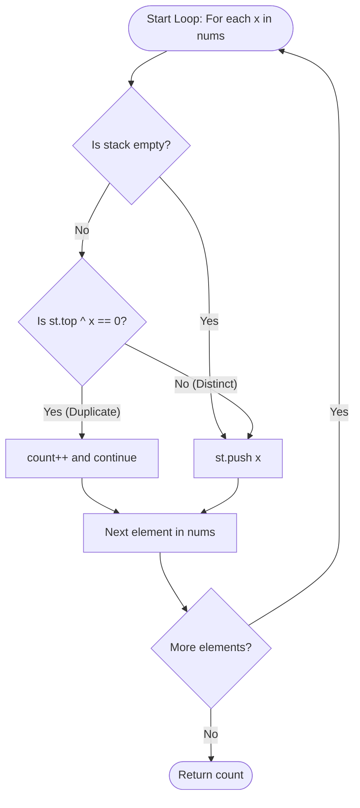

<h2><a href="https://leetcode.com/problems/minimum-deletions-to-make-array-sharp">4083. Minimum Deletions to Make Array Sharp</a></h2>

<p>You are given an integer array <code>nums</code>.</p>

<p>You may delete any number of elements from <code>nums</code>. The remaining elements keep their original order.</p>

<p>The resulting array <code>a</code> is <strong>sharp</strong> if the <strong>bitwise XOR</strong> of every pair of <strong>adjacent</strong> elements is <strong>non-zero</strong>. That is, <code>a[i] XOR a[i + 1] != 0</code> for every index <code>i</code> such that <code>0 &lt;= i &lt; a.length - 1</code>. An array with <strong>at most</strong> one element is sharp.</p>

<p>Return the <strong>minimum</strong> number of deletions needed to make <code>nums</code> sharp.</p>

<p><strong>Bitwise XOR</strong> compares the corresponding bits of two integers. A bit in the result is 1 if the corresponding bits differ, and 0 otherwise.</p>

<p>&nbsp;</p>
<p><strong class="example">Example 1:</strong></p>

<div class="example-block">
<p><strong>Input:</strong> <span class="example-io">nums = [1,1,2,2,2,3]</span></p>

<p><strong>Output:</strong> <span class="example-io">3</span></p>

<p><strong>Explanation:</strong></p>

<ul>
	<li>The pairs at indices <code>(0, 1)</code>, <code>(2, 3)</code>, and <code>(3, 4)</code> each have an XOR of 0.</li>
	<li>Deleting one 1 and two 2s leaves <code>[1, 2, 3]</code>, where <code>1 XOR 2 == 3</code> and <code>2 XOR 3 == 1</code> are both non-zero. Therefore, the answer is 3.</li>
</ul>
</div>

<p><strong class="example">Example 2:</strong></p>

<div class="example-block">
<p><strong>Input:</strong> <span class="example-io">nums = [4,4,9,4]</span></p>

<p><strong>Output:</strong> <span class="example-io">1</span></p>

<p><strong>Explanation:</strong></p>

<ul>
	<li>The pair at indices <code>(0, 1)</code> has an XOR of 0.</li>
	<li>Deleting either of these two 4s leaves <code>[4, 9, 4]</code>, where <code>4 XOR 9 == 13</code> and <code>9 XOR 4 == 13</code> are both non-zero.</li>
</ul>
</div>

<p>&nbsp;</p>
<p><strong>Constraints:</strong></p>

<ul>
	<li><code>2 &lt;= nums.length &lt;= 100</code></li>
	<li><code>1 &lt;= nums[i] &lt;= 100</code></li>
</ul>


---

# 🛍️ Minimum-Deletions-to-Make-Array-Sharp | Explained

## Approach 1: Stack-Based Adjacent Deduplication via Bitwise XOR
### Intuition
Imagine an assembly line conveyor belt where items are placed one by one into an output container. A quality control rule dictates that no two consecutive items can be identical. When an incoming item arrives at the packing station, the inspector glances at the item currently resting on top of the container:
- If the new item matches the one already on top, it violates the non-identical adjacency condition. The inspector discards the new item immediately into a discard bin and moves on.
- If the new item is different (or if the container is currently empty), it is accepted and placed on top.

This greedy strategy guarantees the minimum number of deletions because discarding an element that conflicts with its immediate predecessor is strictly necessary to resolve that specific adjacent conflict. The bitwise XOR operation (`st.top() ^ x == 0`) works because the XOR of two identical integers always yields zero, providing an algebraic identity check.

### Algorithm Visualized



### Approach
1. **Initialize Tracking Structures:** Maintain an integer counter `count` initialized to `0` to track the total deletions performed, and an auxiliary stack `st` of integers to track the sequence of retained elements.
2. **Iterate Through Array:** Traverse the input array `nums` from left to right, inspecting each element `x`.
3. **Compare with Preceding Valid Element:**
   - If the stack is not empty, evaluate whether the incoming element `x` is identical to the current `st.top()`.
   - The comparison is conducted using the bitwise XOR operator: `(st.top() ^ x) == 0`. By definition, $A \oplus B = 0 \iff A = B$.
   - If the values are identical, increment `count` by `1` and invoke `continue` to bypass adding `x` to the stack.
4. **Accept Valid Elements:** If the stack is empty or the element is not identical to `st.top()`, push `x` onto `st`.
5. **Return Total Deletions:** Once the loop finishes, return `count`.

### Detailed Code Analysis

```cpp
1class Solution {
2public:
3    int minDeletions(vector<int>& nums) {
4        int count=0;
5        stack<int> st;
```
- **Lines 3–5:** Defines the entry point `minDeletions`. `count` is initialized to zero to record every skipped (deleted) duplicate. `stack<int> st` is initialized to hold the non-deleted elements.

```cpp
6        for(int x:nums){
7            if(!st.empty()){
8                if((st.top()^x)==0) {count++; continue;}
9            }
10            st.push(x);
11        }
```
- **Line 6:** Range-based for loop sequentially visiting each element `x` of `nums`.
- **Line 7:** Guard condition `!st.empty()` prevents calling `st.top()` on an empty container (which causes undefined behavior / segmentation fault on the first iteration).
- **Line 8:** Evaluates `(st.top() ^ x) == 0`.
  - Operator precedence note: The parentheses around `(st.top() ^ x)` are strictly required in C++ because the equality operator `==` has higher precedence than the bitwise XOR operator `^`.
  - If identical, `count++` increments the deletion tally, and `continue` jumps to the next iteration of the loop, effectively dropping `x`.
- **Line 10:** If `st` is empty or `x` differed from `st.top()`, `st.push(x)` records `x` as the new tail of the reduced array.

```cpp
12        return count;
13    }
14};
```
- **Lines 12–14:** Returns the accumulated count of deleted elements, ending execution.

### Code
```cpp
class Solution {
public:
    int minDeletions(vector<int>& nums) {
        int count = 0;
        stack<int> st;
        for (int x : nums) {
            if (!st.empty()) {
                if ((st.top() ^ x) == 0) {
                    count++;
                    continue;
                }
            }
            st.push(x);
        }
        return count;
    }
};
```

### Complexity
- **Time Complexity:** $\mathcal{O}(N)$, where $N$ is the number of elements in `nums`. We traverse the array exactly once. In each iteration, stack operations (`empty`, `top`, `push`) and arithmetic bitwise XOR operations execute in $\mathcal{O}(1)$ constant time.
- **Space Complexity:** $\mathcal{O}(N)$. In the worst-case scenario where no two adjacent elements are equal (e.g., `[1, 2, 3, 4]`), every element is pushed onto `st`, consuming up to $N$ entries in auxiliary memory.

---

## 🕵️‍♂️ Follow-up Questions (Optional)

1. **Can this solution be optimized to $\mathcal{O}(1)$ auxiliary space?**
   - **Answer:** Yes. Notice that the stack is only ever queried for `st.top()` and never popped. Therefore, you do not need an entire stack; you only need a single variable (e.g., `int prev = -1` or `optional<int> prev`) to store the most recently retained value. This drops the auxiliary space from $\mathcal{O}(N)$ down to $\mathcal{O}(1)$.

2. **Why use `(st.top() ^ x) == 0` instead of `st.top() == x`?**
   - **Answer:** Functionally, both expressions produce identical boolean results for integers. Modern optimizing compilers (GCC/Clang) generate identical assembly instructions (typically `cmp` or `xor` followed by a conditional jump/test) for both forms. However, standard equality `st.top() == x` is generally preferred in production codebases for readability and to avoid operator precedence bugs.